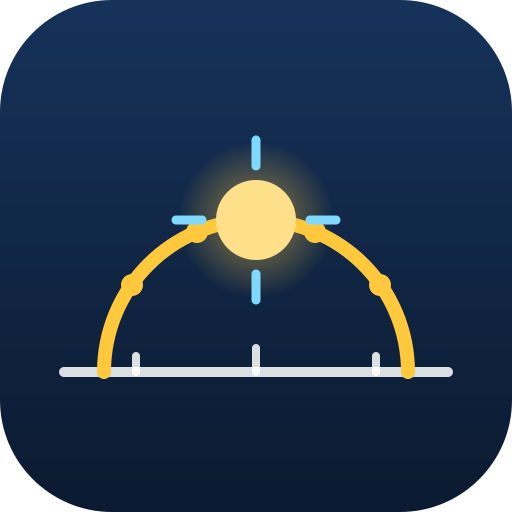

<p align="center">
  
</p>

# sunradar

**Website and web app: <https://andiwand.github.io/almucantar/>**

sunradar shows the path of the sun on top of the camera image. You can see when the
sun is at a given place in the sky, for example when you visit a flat. See
[PLAN.md](PLAN.md) for the design and the milestones.

## Features

- The path of the sun with the hours, the horizon, and the summer and winter paths, on
  the camera image or on a sky view.
- Point the crosshair at a window or a gap between roofs: the app shows the time when
  the sun is in that direction, and the days of the year when the sun is in the crosshair.
- Any date and time, with sunrise and sunset.
- A heading filter for indoor use. Align the heading with the sun, the moon, or a
  landmark on a map. The Android and iOS apps find the sun in the camera image.
- The sun to 0.015° or better, measured against NASA JPL Horizons.

## Download

The first pre-release is 0.1.0. It is not ready for all users yet.

| What | Where |
|---|---|
| Android app | the APK of [android-v0.2.0](https://github.com/andiwand/almucantar/releases/tag/android-v0.2.0) (a debug build: allow the installation from this source) |
| Web app | <https://andiwand.github.io/almucantar/app/> (also offline after the first visit) |
| iOS app | build it from `ios/` (see [`ios/AGENTS.md`](ios/AGENTS.md)); it is not in the App Store |
| Core packages | the wheels, the npm package, the Android AAR, and the xcframework of [core-v0.2.0](https://github.com/andiwand/almucantar/releases/tag/core-v0.2.0) |

The packages are not on PyPI, npm, or Maven Central yet. Install them from the release:

```sh
# Wheels for Linux x86_64 and macOS arm64, Python 3.10 to 3.14.
pip install sunradar --find-links https://github.com/andiwand/almucantar/releases/expanded_assets/core-v0.2.0
npm install https://github.com/andiwand/almucantar/releases/download/core-v0.2.0/sunradar-core-0.1.0.tgz
```

For Swift, add the package with the tag `0.1.0`:

```swift
.package(url: "https://github.com/andiwand/almucantar.git", from: "0.1.0")
```

## Repository layout

This repository is a monorepo. Each directory is a self-contained project.

| Path | Content |
|---|---|
| `core/` | the C++20 core: solar models, projection, search |
| `core/python/` | the Python package `sunradar` |
| `core/android/` | the Android AAR `at.stefl.almucantar:core-android` |
| `android/` | the Android app (Kotlin, Jetpack Compose) |
| `core/apple/` | the Swift package `Sunradar` (`Package.swift` at the root) |
| `core/wasm/` | the npm package `@almucantar/core` (WebAssembly) |
| `pwa/` | the PWA (TypeScript, the core as WebAssembly) |
| `website/` | the website on GitHub Pages; the PWA is under `/app/` |
| `ios/` | the iOS app (SwiftUI) |

Agents: read [`AGENTS.md`](AGENTS.md) first.

## License

[MPL-2.0](LICENSE).

## Development

[`AGENTS.md`](AGENTS.md) has the setup, the layout, the conventions, and the release flow.
Each project has its own build and test steps, for example
[`core/AGENTS.md`](core/AGENTS.md) for the C++ core.
